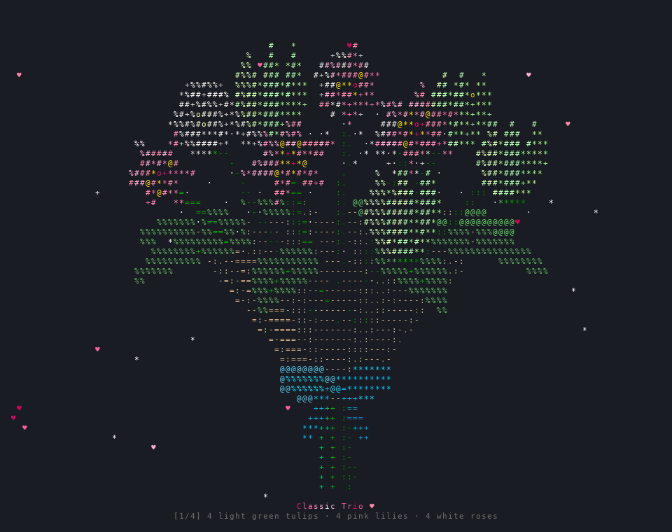
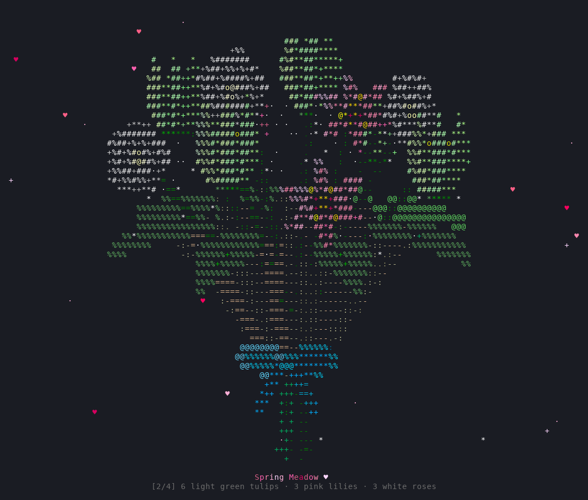
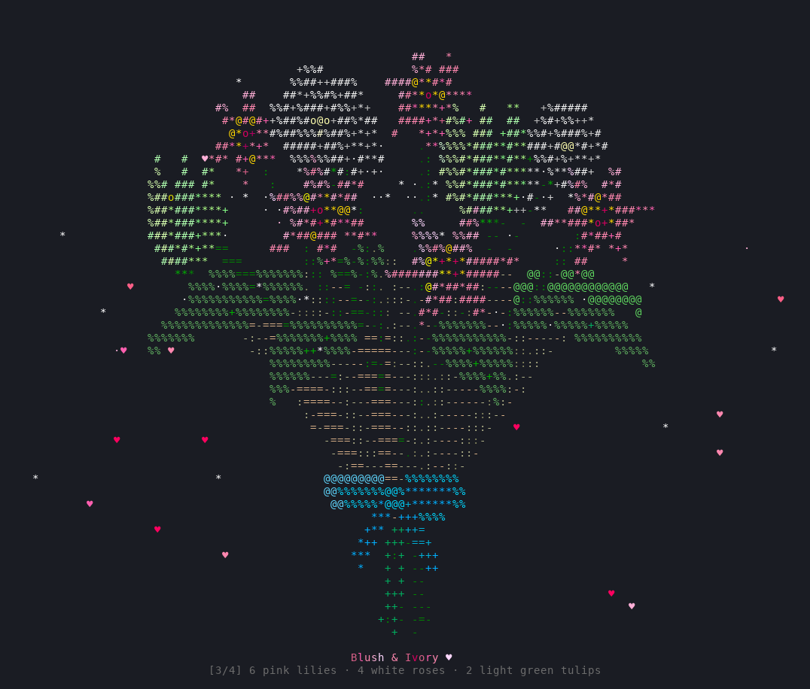
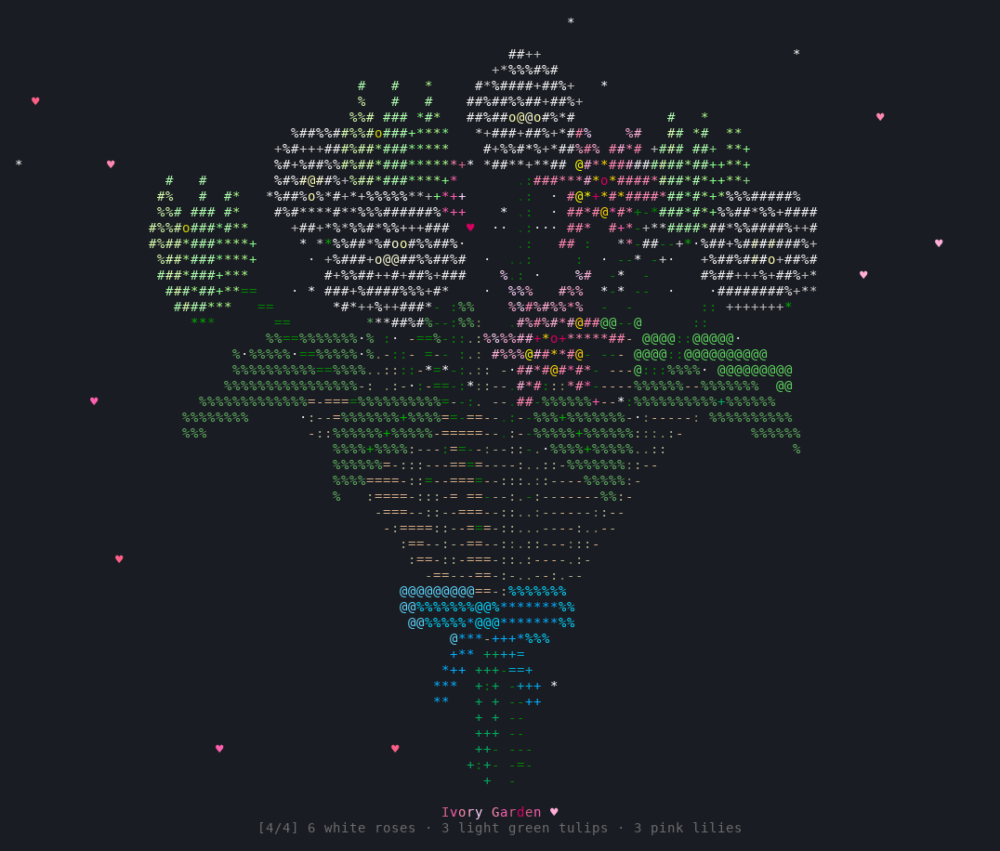

# Ascii Flower Bouquet

A spinning 3D flower bouquet that runs right in your terminal. This update keeps the original motion, tilt, camera, and wrapping from [Umbrellaisnothere/Ascii-Flower-Bouquet](https://github.com/Umbrellaisnothere/Ascii-Flower-Bouquet) (originally by [Alish Sharma](https://github.com/alishsharma17/Ascii-Flower-Bouquet-)) and changes the flowers and the band that holds them together.

The bouquet is made of three flower types, each in its own file:

- **Light green tulips**
- **Pink lilies**
- **White roses**

They are combined into **4 selectable or cycling 12-flower bouquets**, each tied with an **ocean-blue ribbon band and bow** that rotates with the bouquet.

<p align="center">
  
</p>

<p align="center">
  
</p>

Spin speed (`0.6 rad/s`), camera distance (`4.0`), tilt (`0.30 rad`), shading ramps, paper wrap, baby's breath, sparkles, and floating hearts are unchanged from the original repository.

## Flowers used

Each flower is a standalone entity: you can run its file on its own, or combine them into a bouquet.

### Light green tulip — `tulip.py`

A cup-shaped tulip with **three pointed lips**, a pale throat in the notches between the lips, a darker green calyx at the base, and two upward-sweeping leaves on a single stem.

- **Color:** light spring / mint green (distinct from the darker leaf and stem greens)
- **Run it:** `python3 tulip.py`

<p align="center">
  
</p>

### Pink lily — `lily.py`

A six-petaled lily with **pointed, clearly separated petals**, a deep rose throat, golden stamens and anthers in the center, and a green calyx visible from the back.

- **Color:** vivid pink petals with a darker rose-magenta throat and gold stamens
- **Run it:** `python3 lily.py`

<p align="center">
  
</p>

### White rose — `rose.py`

A **layered spiral** rose with a ruffled five-lobed outer edge, cream-ivory bud heart, and green sepals at the base.

- **Color:** warm white / alabaster petals with a cream center
- **Run it:** `python3 rose.py`

<p align="center">
  
</p>

### Ocean-blue band and bow — `band.py`

A 3D ocean-blue **collar band** wrapped around the paper cone, with a center knot, sculpted bow loops, and two hanging tails. It is part of the bouquet, so it **rotates with the spin**. Flowers and stems stay above or below the band and do not pass through it.

- **Color:** deep navy through cerulean to sea-spray cyan
- **Run it:** `python3 band.py`

<p align="center">
  
</p>

## The 4 bouquets

Each arrangement has **12 flowers**. Pick one with `--bouquet 1..4`, or cycle through all four with `--cycle`.

| # | Name | Mix | Preview |
| --- | --- | --- | --- |
| 1 | **Classic Trio** | 4 light green tulips, 4 pink lilies, 4 white roses | [bouquet_1.png](some_previews/bouquet_1.png) |
| 2 | **Spring Meadow** | 6 light green tulips, 3 pink lilies, 3 white roses | [bouquet_2.png](some_previews/bouquet_2.png) |
| 3 | **Blush & Ivory** | 6 pink lilies, 4 white roses, 2 light green tulips | [bouquet_3.png](some_previews/bouquet_3.png) |
| 4 | **Ivory Garden** | 6 white roses, 3 light green tulips, 3 pink lilies | [bouquet_4.png](some_previews/bouquet_4.png) |

<p align="center">
  
  
  
</p>

The layouts and render engine live in `bouquets.py` and `engine.py`. `bouquet3d.py` is the main CLI.

## Run it

You only need **Python 3**. No packages are required to run anything in the terminal.

```bash
# Bouquet 1 (Classic Trio)
python3 bouquet3d.py

# Choose a specific bouquet (1..4)
python3 bouquet3d.py --bouquet 2

# Cycle through all 4 bouquets automatically
python3 bouquet3d.py --cycle

# Run each flower, or the band, on its own
python3 tulip.py
python3 lily.py
python3 rose.py
python3 band.py
```

Press `Ctrl+C` to stop.

### Optional flags

- `--frames N`: render `N` plain-text frames and exit
- `--save-frames DIR`: save plain-text frames to `DIR`
- `--cols N --rows N`: override terminal dimensions
- `--speed RAD`: override spin speed (default `0.6`)
- `--message TEXT`: customize the message under the bouquet
- `--preview` / `--all-previews`: write PNG/GIF previews to `previews/` (requires [Pillow](https://pypi.org/project/pillow/), used only for image export)

## Tips

- Make the terminal window roomy, or zoom out slightly (`Ctrl -` / `Cmd -`), so the petals stay readable.
- Use a terminal that supports 256 colors (macOS Terminal, iTerm2, Windows Terminal, VS Code, or most Linux terminals).

## License & credit

MIT License — NOTICE `Umbrellaisnothere/Ascii-Flower-Bouquet`). See `LICENSE`.